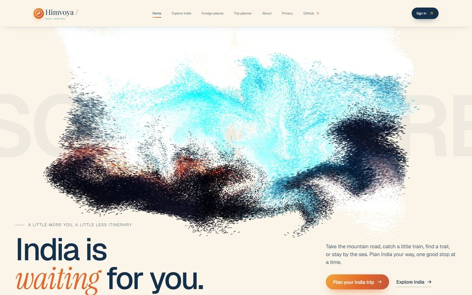
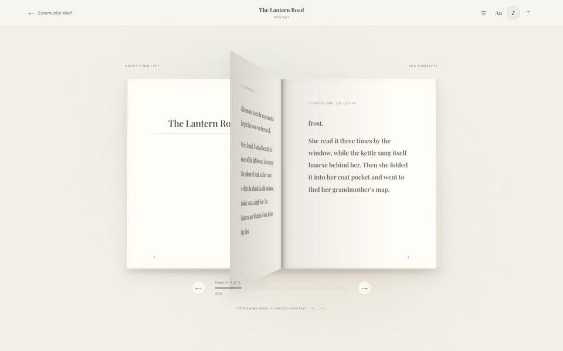
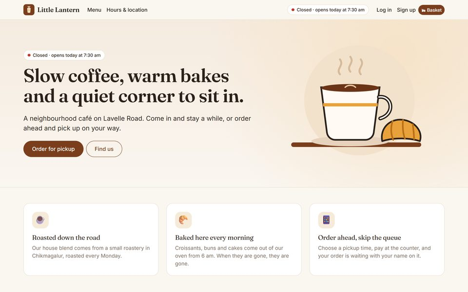
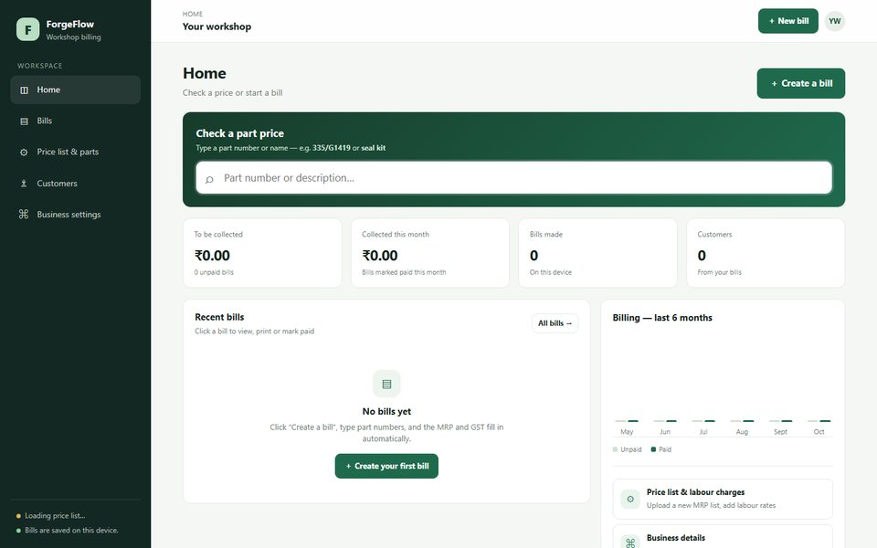
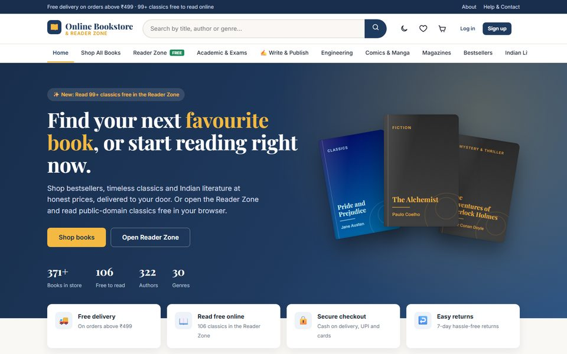
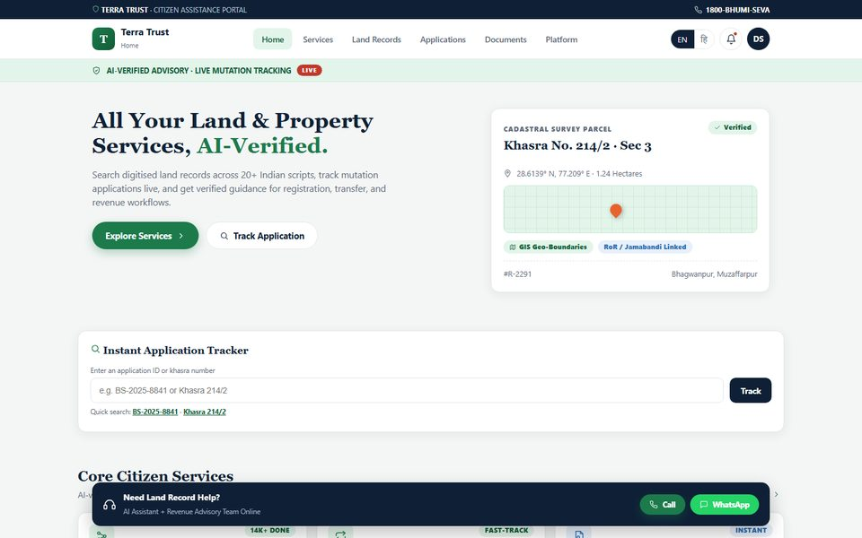

<!-- Banner (follows the visitor's light / dark GitHub theme) -->
<a href="https://digvijay165.github.io/portfolio/">
  <picture>
    <source media="(prefers-color-scheme: dark)" srcset="./assets/banner-dark.svg" />
    <source media="(prefers-color-scheme: light)" srcset="./assets/banner-light.svg" />
    
  </picture>
</a>

  
  
  

<table>
  <tr>
    <td width="66%" valign="middle">
      <h2>Hi, I'm Digvijay 👋</h2>
      

        I'm a <b>student and front-end developer from Kota, India</b>. I like turning everyday problems into
        <b>fast, friendly web apps</b>: a travel planner for the Himalayas, a book reader with real 3D page turns,
        GST billing software for a real machine-parts workshop, and a land-records portal for Smart India Hackathon 2026.
      

      

        🛠️ &nbsp;Building full-stack apps with <b>React, TypeScript, Node.js and Postgres</b> 
        🧠 &nbsp;Practising <b>data structures &amp; algorithms</b> on <a href="https://github.com/digvijay165/LeetCode">LeetCode</a> 
        🌱 &nbsp;Learning advanced TypeScript, Three.js and accessibility 
        🤝 &nbsp;<b>Open to internships</b> and collaborations
      

    </td>
    <td width="34%" align="center" valign="middle">
      
    </td>
  </tr>
</table>

## 🚀 Featured projects

<table>
  <tr>
    <td width="50%" valign="top">
      
      <h3>🏔️ Himvoya</h3>
      
India-first travel planner: 106 destination guides including 30 Himalayan treks, maps, live weather, accounts and a day-by-day trip planner.

      
<code>React</code> <code>TypeScript</code> <code>Tailwind</code> <code>Express</code> <code>SQLite</code>

      <a href="https://himvoya-travel-planner.onrender.com/"><b>Live site ↗</b></a> &nbsp;·&nbsp; <a href="https://github.com/digvijay165/himvoya-travel-planner">Code</a>
    </td>
    <td width="50%" valign="top">
      
      <h3>📚 Shelfspace</h3>
      
A cozy book library with a 3D page-turning reader, soft paper sounds and an admin-approved community shelf. No framework, no build step.

      
<code>JavaScript</code> <code>Node.js</code> <code>PostgreSQL</code>

      <a href="https://shelfspace-u4i2.onrender.com"><b>Live site ↗</b></a> &nbsp;·&nbsp; <a href="https://github.com/digvijay165/Shelfspace">Code</a>
    </td>
  </tr>
  <tr>
    <td width="50%" valign="top">
      
      <h3>☕ Little Lantern Café</h3>
      
Café website with menu, opening hours, map and order-ahead pickup slots, plus a live staff dashboard for orders and sales.

      
<code>React</code> <code>Bootstrap</code> <code>Node.js</code> <code>PostgreSQL</code> <code>Docker</code>

      <a href="https://little-lantern-cafe.onrender.com"><b>Live site ↗</b></a> &nbsp;·&nbsp; <a href="https://github.com/digvijay165/cafe-website">Code</a>
    </td>
    <td width="50%" valign="top">
      
      <h3>🧾 ForgeFlow</h3>
      
GST billing, stock, purchases and reports for machine-parts workshops. Type a part number, press Enter, and MRP and GST fill in.

      
<code>JavaScript</code> <code>IndexedDB</code> <code>Supabase</code>

      <a href="https://digvijay165.github.io/billing/"><b>Live app ↗</b></a> &nbsp;·&nbsp; <a href="https://github.com/digvijay165/billing">Code</a>
    </td>
  </tr>
  <tr>
    <td width="50%" valign="top">
      
      <h3>📖 Online Bookstore &amp; Reader</h3>
      
A bookstore with 541 titles, 246 free classics in an online reader, community publishing with editor review, and two-step verification.

      
<code>JavaScript</code> <code>Node.js</code> <code>Express</code> <code>SQLite</code>

      <a href="https://online-bookstore-and-reader-platform.onrender.com"><b>Live site ↗</b></a> &nbsp;·&nbsp; <a href="https://github.com/digvijay165/Online-bookstore-and-reader-platform">Code</a>
    </td>
    <td width="50%" valign="top">
      
      <h3>🏛️ Terra Trust</h3>
      
Smart India Hackathon 2026 prototype: AI-verified land records with khasra search, a GIS map pin, an application tracker and EN / हिंदी.

      
<code>React</code> <code>JavaScript</code>

      <a href="https://terra-trust.onrender.com"><b>Live demo ↗</b></a> &nbsp;·&nbsp; <a href="https://github.com/digvijay165/terra-trust">Code</a>
    </td>
  </tr>
</table>

  
<b>More projects</b>

   

| Project | What it is | Links |
| --- | --- | --- |
| 🌌 **3D Portfolio** | Interactive portfolio with Three.js, GLSL shaders and page transitions | [Live](https://digvijay165.github.io/portfolio/) · [Code](https://github.com/digvijay165/portfolio) |
| 🛍️ **Mosaic Market** | React storefront with search, filters, favourites and a cart | [Live](https://mosaic-market-alpha.vercel.app/) · [Code](https://github.com/digvijay165/mosaic-market) |
| 🎧 **Pulse Player** | Browser music player with search, queue and favourites | [Live](https://pulse-player-0rdw.onrender.com/) · [Code](https://github.com/digvijay165/pulse-player) |
| 👗 **Rewear** | Wardrobe stylist that builds outfits from clothes you already own | [Live](https://digvijay165.github.io/rewear-wardrobe-stylist/) · [Code](https://github.com/digvijay165/rewear-wardrobe-stylist) |
| 🧾 **ForgeFlow Classic** | The original billing app with a built-in 65,000-part price list | [Live](https://digvijay165.github.io/machine-shop-billing/) · [Code](https://github.com/digvijay165/machine-shop-billing) |
| 🧮 **Calcu** | Scientific calculator with history, memory and light / dark themes | [Live](https://calculator-7rgb.onrender.com) · [Code](https://github.com/digvijay165/calculator) |
| 🧠 **LeetCode** | My DSA solutions, synced automatically from LeetCode | [Code](https://github.com/digvijay165/LeetCode) |

<!-- PROJECTS:START -->
<!-- PROJECTS:END -->

## 🛠️ Tech stack

<table>
  <tr>
    <td align="center" width="50%">
      <b>LANGUAGES</b>  
      <picture>
        <source media="(prefers-color-scheme: dark)" srcset="https://skillicons.dev/icons?i=ts,js,html,css,cpp,java&theme=dark" />
        
      </picture>
    </td>
    <td align="center" width="50%">
      <b>FRONT-END</b>  
      <picture>
        <source media="(prefers-color-scheme: dark)" srcset="https://skillicons.dev/icons?i=react,vite,tailwind,bootstrap,threejs&theme=dark" />
        
      </picture>
    </td>
  </tr>
  <tr>
    <td align="center" width="50%">
      <b>BACK-END &amp; DATA</b>  
      <picture>
        <source media="(prefers-color-scheme: dark)" srcset="https://skillicons.dev/icons?i=nodejs,express,postgres,sqlite,supabase&theme=dark" />
        
      </picture>
    </td>
    <td align="center" width="50%">
      <b>TOOLS &amp; DEPLOY</b>  
      <picture>
        <source media="(prefers-color-scheme: dark)" srcset="https://skillicons.dev/icons?i=git,github,githubactions,docker,vercel&theme=dark" />
        
      </picture>
    </td>
  </tr>
</table>

## 📊 GitHub activity

  <picture>
    <source media="(prefers-color-scheme: dark)" srcset="https://github-readme-stats.vercel.app/api?username=digvijay165&show_icons=true&hide_border=true&rank_icon=github&theme=github_dark&bg_color=0d1117" />
    
  </picture>
  <picture>
    <source media="(prefers-color-scheme: dark)" srcset="https://streak-stats.demolab.com?user=digvijay165&hide_border=true&theme=github-dark-blue&background=0d1117" />
    
  </picture>

---

  Thanks for stopping by! Try one of the live demos above, or <a href="mailto:digvijaysingh5360@gmail.com">send me an email</a> about internships and collaborations.
    
  

