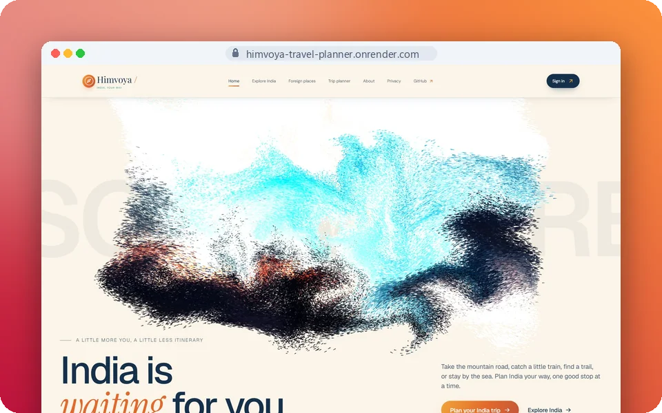
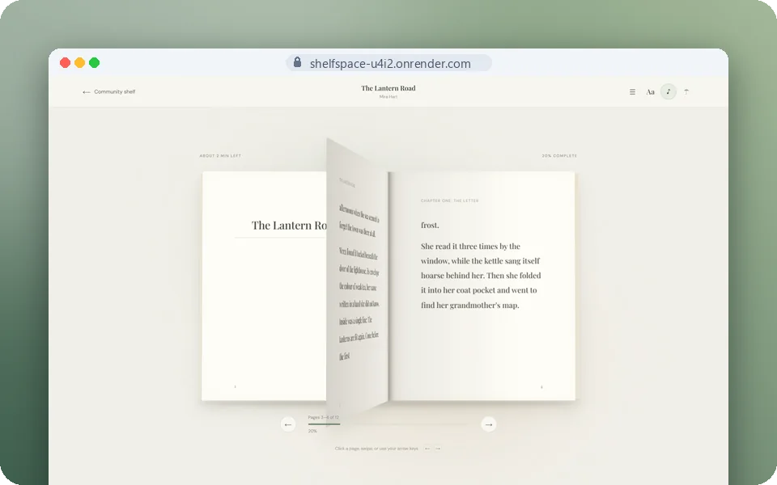
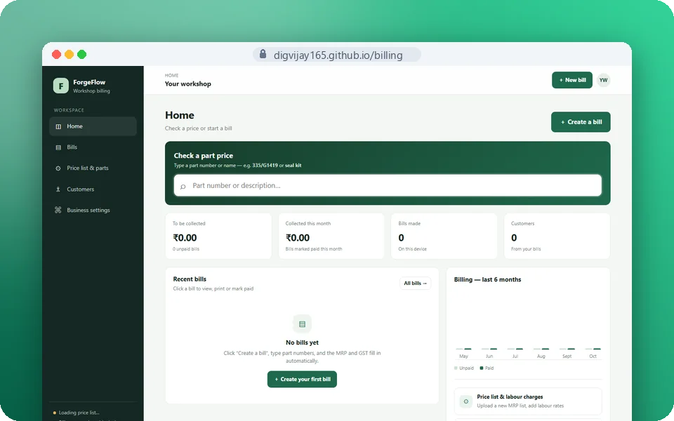
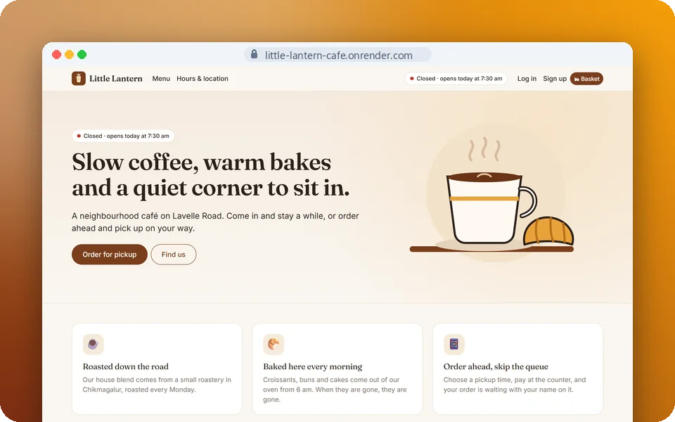
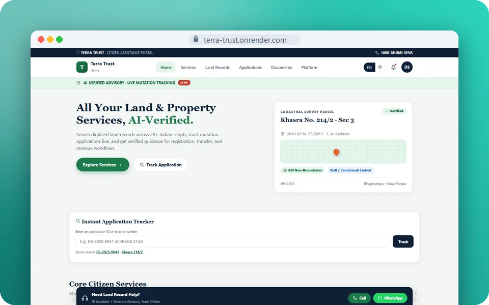

<!-- Banner (follows the visitor's light / dark GitHub theme) -->
<picture>
    <source media="(prefers-color-scheme: dark)" srcset="./assets/banner-dark.svg" />
    <source media="(prefers-color-scheme: light)" srcset="./assets/banner-light.svg" />
    
  </picture>

  
  
  
  
  

<table>
  <tr>
    <td width="66%" valign="middle">
      <h2>Hi, I'm Digvijay 👋</h2>
      

        I'm a <b>student and full-stack developer from Kota, India</b>. I like turning everyday problems into
        <b>fast, friendly web apps</b>: a travel planner for the Himalayas, a book reader with real 3D page turns,
        GST billing software for a real machine-parts workshop, and a land-records portal for Smart India Hackathon 2026.
        Lately I've been going a level deeper and <b>rebuilding the tools I use from scratch</b>, starting with a Redis-compatible server in plain Java.
      

      

        🛠️ &nbsp;Building full-stack apps with <b>React, TypeScript, Node.js and Postgres</b> 
        ☕ &nbsp;Writing <b>systems from scratch in Java</b>: mini-redis is done, an HTTP server is next 
        🧠 &nbsp;Practising <b>data structures &amp; algorithms</b> in C++ and Java on <a href="https://leetcode.com/u/DIGVIJAY5360/">LeetCode</a> 
        🐍 &nbsp;Also at home in <b>Python</b>: Django REST APIs, OpenCV, Selenium and scraping 
        🤝 &nbsp;<b>Open to internships</b> and collaborations
      

    </td>
    <td width="34%" align="center" valign="middle">
      
    </td>
  </tr>
</table>

## 🚀 Featured projects

<table>
  <tr>
    <td width="50%" valign="top">
      
      <h3>🏔️ Himvoya</h3>
      
India-first travel planner: 106 destination guides including 30 Himalayan treks, maps, live weather, accounts and a day-by-day trip planner.

      
<code>React</code> <code>TypeScript</code> <code>Tailwind</code> <code>Express</code> <code>SQLite</code>

      <a href="https://himvoya-travel-planner.onrender.com/"><b>Live site ↗</b></a> &nbsp;·&nbsp; <a href="https://github.com/digvijay165/himvoya-travel-planner">Code</a>
    </td>
    <td width="50%" valign="top">
      
      <h3>📚 Shelfspace</h3>
      
A cozy book library with a 3D page-turning reader, soft paper sounds and an admin-approved community shelf. No framework, no build step.

      
<code>JavaScript</code> <code>Node.js</code> <code>PostgreSQL</code> <code>Vercel</code>

      <a href="https://shelfspace-woad.vercel.app"><b>Live site ↗</b></a> &nbsp;·&nbsp; <a href="https://github.com/digvijay165/Shelfspace">Code</a>
    </td>
  </tr>
  <tr>
    <td width="50%" valign="top">
      
      <h3>⚡ mini-redis</h3>
      
A Redis-compatible server in plain Java: one NIO event loop, the RESP protocol with pipelining, 39 commands, key expiry and crash-safe persistence.

      
<code>Java 21</code> <code>NIO</code> <code>JUnit</code> <code>Maven</code>

      <a href="https://github.com/digvijay165/java-projects/tree/main/mini-redis"><b>How it works ↗</b></a> &nbsp;·&nbsp; <a href="https://github.com/digvijay165/java-projects">All Java projects</a>
    </td>
    <td width="50%" valign="top">
      
      <h3>🧾 ForgeFlow</h3>
      
GST billing, stock, purchases and reports for machine-parts workshops. Type a part number, press Enter, and MRP and GST fill in.

      
<code>JavaScript</code> <code>IndexedDB</code> <code>Supabase</code>

      <a href="https://digvijay165.github.io/ForgeFlow-Workshop-Billing/"><b>Live app ↗</b></a> &nbsp;·&nbsp; <a href="https://github.com/digvijay165/ForgeFlow-Workshop-Billing">Code</a>
    </td>
  </tr>
  <tr>
    <td width="50%" valign="top">
      
      <h3>☕ Little Lantern Café</h3>
      
Café website with menu, opening hours, map and order-ahead pickup slots, plus a live staff dashboard for orders and sales.

      
<code>React</code> <code>Bootstrap</code> <code>Node.js</code> <code>PostgreSQL</code> <code>Docker</code>

      <a href="https://little-lantern-cafe.onrender.com"><b>Live site ↗</b></a> &nbsp;·&nbsp; <a href="https://github.com/digvijay165/cafe-website">Code</a>
    </td>
    <td width="50%" valign="top">
      
      <h3>🏛️ Terra Trust</h3>
      
Smart India Hackathon 2026 prototype: AI-verified land records with khasra search, a GIS map pin, an application tracker and EN / हिंदी.

      
<code>React</code> <code>JavaScript</code>

      <a href="https://terra-trust.onrender.com"><b>Live demo ↗</b></a> &nbsp;·&nbsp; <a href="https://digvijay165.github.io/portfolio/project.html?p=terra-trust">Case study</a>
    </td>
  </tr>
</table>

  
<b>🌐 More web apps</b>

   

| Project | What it is | Links |
| --- | --- | --- |
| 📖 **Online Bookstore &amp; Reader** | 541 titles, 246 free classics in an online reader, community publishing with editor review, and two-step verification | [Live](https://online-bookstore-and-reader-platform.onrender.com) · [Code](https://github.com/digvijay165/Online-bookstore-and-reader-platform) |
| ✨ **Portfolio** | Multi-page glass portfolio with view transitions, a command menu and live GitHub / LeetCode stats | [Live](https://digvijay165.github.io/portfolio/) · [Code](https://github.com/digvijay165/portfolio) |
| 🛍️ **Mosaic Market** | React storefront with search, filters, favourites and a cart | [Live](https://mosaic-market-alpha.vercel.app/) · [Code](https://github.com/digvijay165/mosaic-market) |
| 🎧 **Pulse Player** | Browser music player with search, queue and favourites | [Live](https://pulse-player-0rdw.onrender.com/) · [Code](https://github.com/digvijay165/pulse-player) |
| 👗 **Rewear** | Wardrobe stylist that builds outfits from clothes you already own | [Live](https://digvijay165.github.io/rewear-wardrobe-stylist/) · [Code](https://github.com/digvijay165/rewear-wardrobe-stylist) |
| 🧮 **Calcu** | Scientific calculator with history, memory and light / dark themes | [Live](https://calculator-7rgb.onrender.com) · [Code](https://github.com/digvijay165/calculator) |

  
<b>🐍 Python, C++ &amp; DSA</b>

   

| Project | What it is | Links |
| --- | --- | --- |
| 📝 **Django REST Blog API** | Blog-post API with login, per-user ownership, search, date filters, ordering and pagination | [Code](https://github.com/digvijay165/django-rest-blog-api) |
| 💬 **Python Chat App** | Two-window desktop chat over TCP sockets, with a background listener thread and a Tkinter UI | [Code](https://github.com/digvijay165/python-chat-app) |
| 👁️ **OpenCV Practicals** | 12 computer-vision practicals, from resizing an image to Canny edge detection and webcam capture | [Code](https://github.com/digvijay165/opencv-practicals) |
| 🤖 **Selenium Automation** | Scripts that drive Chrome: a Google search, an Amazon product search and a Wikipedia walk | [Code](https://github.com/digvijay165/selenium-automation) |
| 🕸️ **Web Scraper** | Scrapes book titles, prices and covers and compares each price to a target | [Code](https://github.com/digvijay165/python-web-scraper) |
| 🐘 **Python + PostgreSQL** | Creating a database, a table and records with psycopg2 and parameterized queries | [Code](https://github.com/digvijay165/python-postgresql) |
| 🌶️ **Flask Registration Form** | Fill in a form and see your details on a confirmation page | [Code](https://github.com/digvijay165/flask-registration-form) |
| 🔢 **Tkinter Calculator** | Desktop calculator with a real window and clickable buttons | [Code](https://github.com/digvijay165/tkinter-calculator) |
| 🐍 **Python Basics** | Ten small programs: input, if/else, loops, functions, files, dictionaries and slicing | [Code](https://github.com/digvijay165/python-basics) |
| ➕ **C++ Assignments** | 24 programs on classes, overloading, inheritance, exceptions, file handling, pointers and the STL | [Code](https://github.com/digvijay165/cpp-assignments) |
| 🧠 **LeetCode** | My DSA solutions, synced automatically from LeetCode | [Profile](https://leetcode.com/u/DIGVIJAY5360/) · [Code](https://github.com/digvijay165/LeetCode) |

<!-- PROJECTS:START -->
<!-- PROJECTS:END -->

## 🛠️ Tech stack

<table>
  <tr>
    <td align="center" width="50%">
      <b>LANGUAGES</b>  
      <picture>
        <source media="(prefers-color-scheme: dark)" srcset="https://skillicons.dev/icons?i=ts%2Cjs%2Cpy%2Cjava%2Ccpp&theme=dark" />
        
      </picture>
    </td>
    <td align="center" width="50%">
      <b>FRONT-END</b>  
      <picture>
        <source media="(prefers-color-scheme: dark)" srcset="https://skillicons.dev/icons?i=html%2Ccss%2Creact%2Ctailwind%2Cbootstrap%2Cthreejs&theme=dark" />
        
      </picture>
    </td>
  </tr>
  <tr>
    <td align="center" width="50%">
      <b>BACK-END &amp; DATA</b>  
      <picture>
        <source media="(prefers-color-scheme: dark)" srcset="https://skillicons.dev/icons?i=nodejs%2Cexpress%2Cdjango%2Cflask%2Cpostgres%2Csqlite&theme=dark" />
        
      </picture>
    </td>
    <td align="center" width="50%">
      <b>TOOLS &amp; CLOUD</b>  
      <picture>
        <source media="(prefers-color-scheme: dark)" srcset="https://skillicons.dev/icons?i=git%2Cgithubactions%2Cdocker%2Cvite%2Cvercel%2Csupabase&theme=dark" />
        
      </picture>
    </td>
  </tr>
</table>

## 📊 GitHub activity

  <picture>
    <source media="(prefers-color-scheme: dark)" srcset="https://raw.githubusercontent.com/digvijay165/digvijay165/output/activity-dark.svg" />
    
  </picture>

  <a href="https://leetcode.com/u/DIGVIJAY5360/">
    <picture>
      <source media="(prefers-color-scheme: dark)" srcset="https://leetcard.jacoblin.cool/DIGVIJAY5360?theme=dark&font=Inter&border=0&radius=16" />
      
    </picture>
  </a>

 

<picture>
    <source media="(prefers-color-scheme: dark)" srcset="./assets/footer-dark.svg" />
    
  </picture>

  

