<!--
  The tiles on this page are drawn by .github/scripts/build_design.py (edit the
  content at the top of it, then run it). The activity card is redrawn every day
  by .github/scripts/build_stats.py. Each tile follows the visitor's light / dark theme.
-->

<picture>
  <source media="(prefers-color-scheme: dark)" srcset="./assets/hero-dark.svg" />
  
</picture>

  <a href="https://digvijay165.github.io/portfolio/"><picture><source media="(prefers-color-scheme: dark)" srcset="./assets/buttons/portfolio-dark.svg" /></picture></a>
  <a href="mailto:digvijaysingh5360@gmail.com"><picture><source media="(prefers-color-scheme: dark)" srcset="./assets/buttons/email-dark.svg" /></picture></a>
  <a href="https://www.linkedin.com/in/digvijay-singh-a188b1382/"><picture><source media="(prefers-color-scheme: dark)" srcset="./assets/buttons/linkedin-dark.svg" /></picture></a>
  <a href="https://leetcode.com/u/DIGVIJAY5360/"><picture><source media="(prefers-color-scheme: dark)" srcset="./assets/buttons/leetcode-dark.svg" /></picture></a>
  <a href="https://www.instagram.com/digvijay.singh_"><picture><source media="(prefers-color-scheme: dark)" srcset="./assets/buttons/instagram-dark.svg" /></picture></a>

 

<picture>
  <source media="(prefers-color-scheme: dark)" srcset="./assets/headers/work-dark.svg" />
  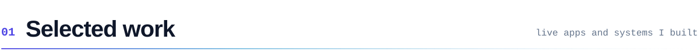
</picture>

  <a href="https://himvoya-travel-planner.onrender.com/"><picture><source media="(prefers-color-scheme: dark)" srcset="./assets/cards/himvoya-dark.svg" />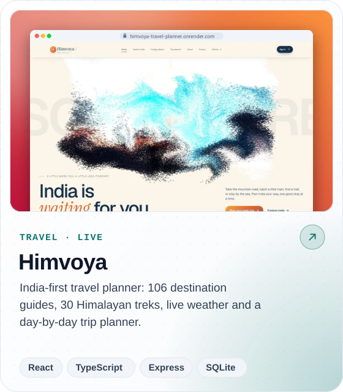</picture></a>
  <a href="https://shelfspace-woad.vercel.app"><picture><source media="(prefers-color-scheme: dark)" srcset="./assets/cards/shelfspace-dark.svg" />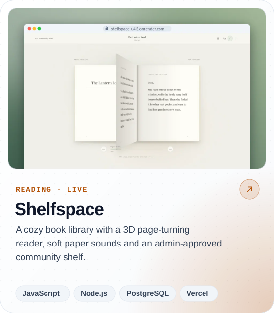</picture></a>

  <a href="https://github.com/digvijay165/java-projects/tree/main/mini-redis"><picture><source media="(prefers-color-scheme: dark)" srcset="./assets/cards/mini-redis-dark.svg" />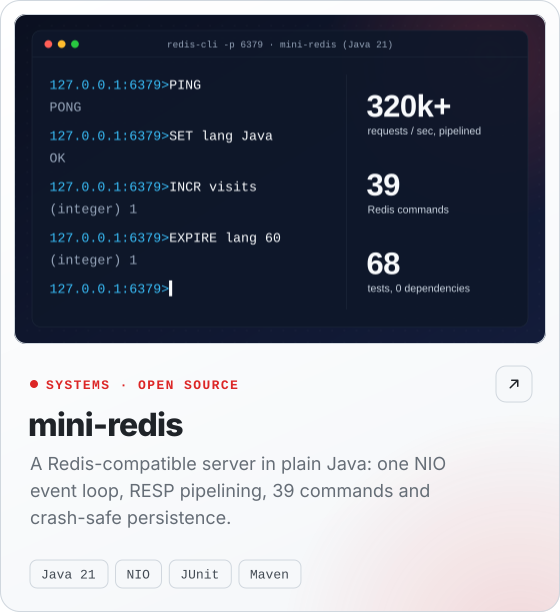</picture></a>
  <a href="https://digvijayy.pages.dev"><picture><source media="(prefers-color-scheme: dark)" srcset="./assets/cards/forgeflow-dark.svg" />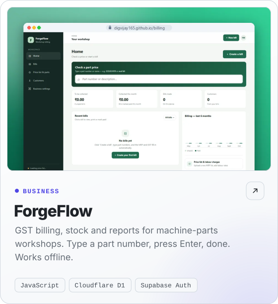</picture></a>

  <a href="https://little-lantern-cafe.onrender.com"><picture><source media="(prefers-color-scheme: dark)" srcset="./assets/cards/little-lantern-cafe-dark.svg" />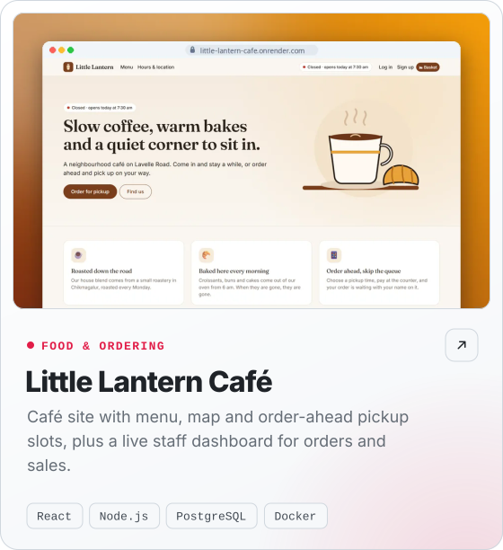</picture></a>
  <a href="https://terra-trust.onrender.com"><picture><source media="(prefers-color-scheme: dark)" srcset="./assets/cards/terra-trust-dark.svg" />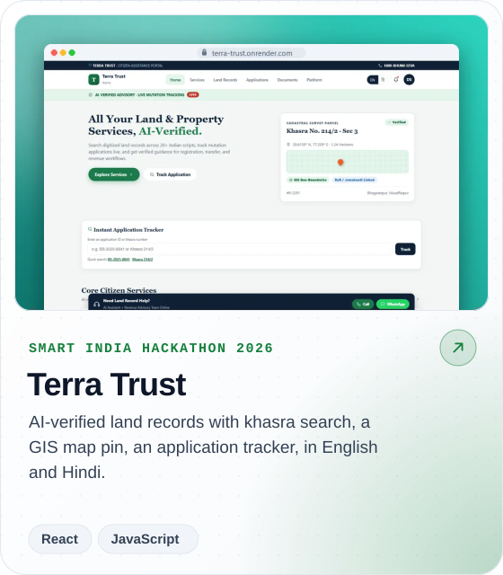</picture></a>

  Click a card to open it. Source code:
  <a href="https://github.com/digvijay165/himvoya-travel-planner">Himvoya</a> ·
  <a href="https://github.com/digvijay165/Shelfspace">Shelfspace</a> ·
  <a href="https://github.com/digvijay165/java-projects">mini-redis</a> ·
  <a href="https://github.com/digvijay165/digvijayy">ForgeFlow</a> (<a href="https://github.com/digvijay165/ForgeFlow-Workshop-Billing">v1</a>) ·
  <a href="https://github.com/digvijay165/cafe-website">Little Lantern Café</a> ·
  <a href="https://digvijay165.github.io/portfolio/project.html?p=terra-trust">Terra Trust case study</a>

 

<picture>
  <source media="(prefers-color-scheme: dark)" srcset="./assets/headers/more-dark.svg" />
  
</picture>

  
<b>🌐 More web apps</b>

   

| Project | What it is | Links |
| --- | --- | --- |
| 📖 **Online Bookstore &amp; Reader** | 541 titles, 246 free classics in an online reader, community publishing with editor review, and two-step verification | [Live](https://online-bookstore-and-reader-platform.onrender.com) · [Code](https://github.com/digvijay165/Online-bookstore-and-reader-platform) |
| ✨ **Portfolio** | Multi-page glass portfolio with view transitions, a command menu and live GitHub / LeetCode stats | [Live](https://digvijay165.github.io/portfolio/) · [Code](https://github.com/digvijay165/portfolio) |
| 🛍️ **Mosaic Market** | React storefront with search, filters, favourites and a cart | [Live](https://mosaic-market-alpha.vercel.app/) · [Code](https://github.com/digvijay165/mosaic-market) |
| 🎧 **Pulse Player** | Browser music player with search, queue and favourites | [Live](https://pulse-player-0rdw.onrender.com/) · [Code](https://github.com/digvijay165/pulse-player) |
| 👗 **Rewear** | Wardrobe stylist that builds outfits from clothes you already own | [Live](https://digvijay165.github.io/rewear-wardrobe-stylist/) · [Code](https://github.com/digvijay165/rewear-wardrobe-stylist) |
| 🧮 **Calcu** | Scientific calculator with history, memory and light / dark themes | [Live](https://calculator-7rgb.onrender.com) · [Code](https://github.com/digvijay165/calculator) |

  
<b>🐍 Python, C++ &amp; DSA</b>

   

| Project | What it is | Links |
| --- | --- | --- |
| 📝 **Django REST Blog API** | Blog-post API with login, per-user ownership, search, date filters, ordering and pagination | [Code](https://github.com/digvijay165/django-rest-blog-api) |
| 💬 **Python Chat App** | Two-window desktop chat over TCP sockets, with a background listener thread and a Tkinter UI | [Code](https://github.com/digvijay165/python-chat-app) |
| 👁️ **OpenCV Practicals** | 12 computer-vision practicals, from resizing an image to Canny edge detection and webcam capture | [Code](https://github.com/digvijay165/opencv-practicals) |
| 🤖 **Selenium Automation** | Scripts that drive Chrome: a Google search, an Amazon product search and a Wikipedia walk | [Code](https://github.com/digvijay165/selenium-automation) |
| 🕸️ **Web Scraper** | Scrapes book titles, prices and covers and compares each price to a target | [Code](https://github.com/digvijay165/python-web-scraper) |
| 🐘 **Python + PostgreSQL** | Creating a database, a table and records with psycopg2 and parameterized queries | [Code](https://github.com/digvijay165/python-postgresql) |
| 🌶️ **Flask Registration Form** | Fill in a form and see your details on a confirmation page | [Code](https://github.com/digvijay165/flask-registration-form) |
| 🔢 **Tkinter Calculator** | Desktop calculator with a real window and clickable buttons | [Code](https://github.com/digvijay165/tkinter-calculator) |
| 🐍 **Python Basics** | Ten small programs: input, if/else, loops, functions, files, dictionaries and slicing | [Code](https://github.com/digvijay165/python-basics) |
| ➕ **C++ Assignments** | 24 programs on classes, overloading, inheritance, exceptions, file handling, pointers and the STL | [Code](https://github.com/digvijay165/cpp-assignments) |
| 🧠 **LeetCode** | My DSA solutions, synced automatically from LeetCode | [Profile](https://leetcode.com/u/DIGVIJAY5360/) · [Code](https://github.com/digvijay165/LeetCode) |

<!-- PROJECTS:START -->
<!-- PROJECTS:END -->

 

<picture>
  <source media="(prefers-color-scheme: dark)" srcset="./assets/headers/toolbox-dark.svg" />
  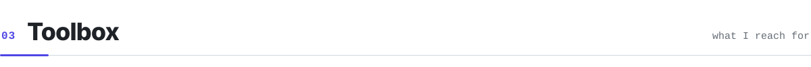
</picture>

<picture>
  <source media="(prefers-color-scheme: dark)" srcset="./assets/toolbox-dark.svg" />
  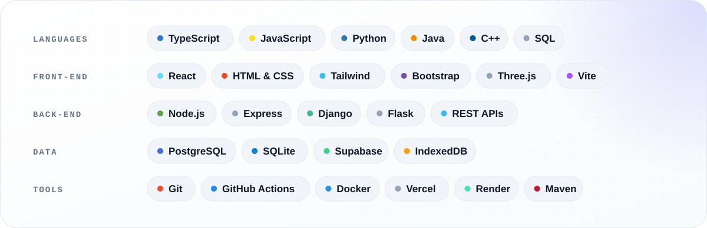
</picture>

  

<picture>
  <source media="(prefers-color-scheme: dark)" srcset="./assets/headers/activity-dark.svg" />
  
</picture>

<picture>
  <source media="(prefers-color-scheme: dark)" srcset="https://raw.githubusercontent.com/digvijay165/digvijay165/output/activity-dark.svg" />
  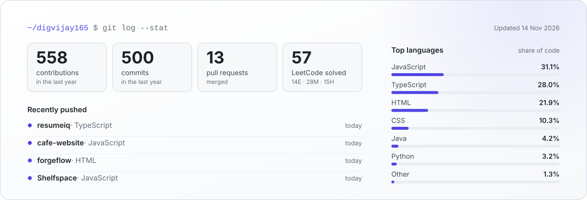
</picture>

  

<a href="mailto:digvijaysingh5360@gmail.com"><picture><source media="(prefers-color-scheme: dark)" srcset="./assets/footer-dark.svg" />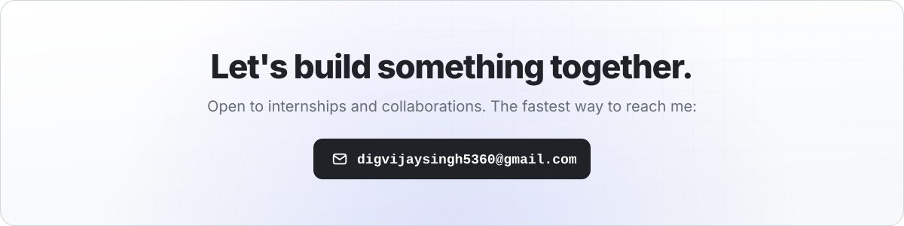</picture></a>

  

